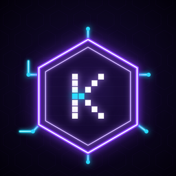
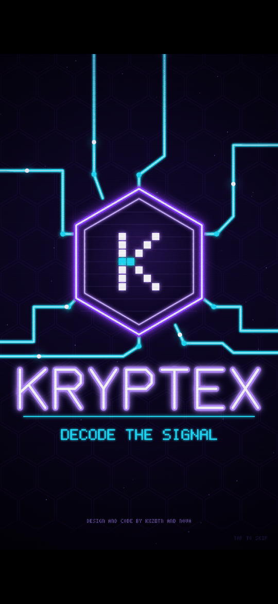
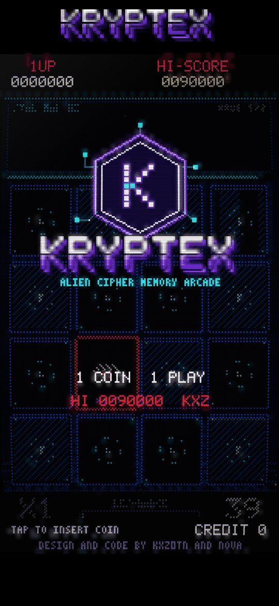
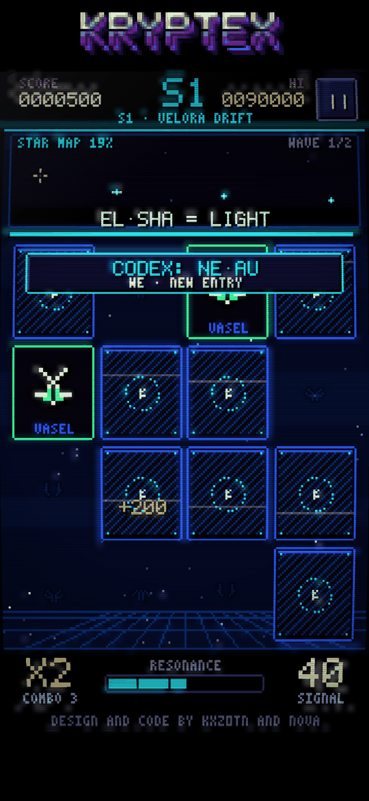
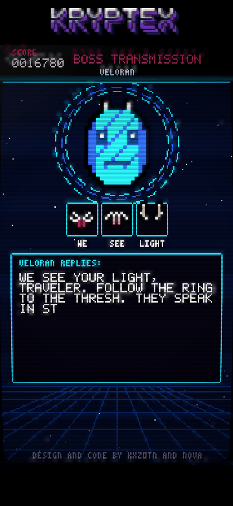
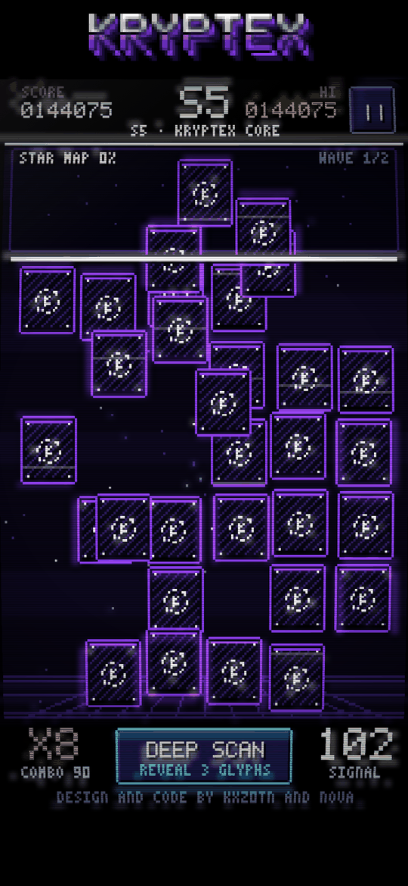
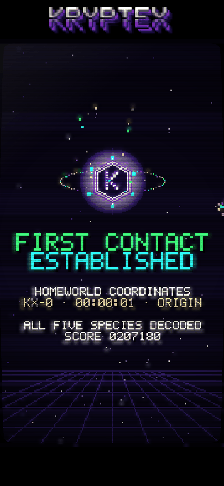

<div align="center">



# KRYPTEX

**Decode the signal. Make first contact.**

A portrait, classic-style neon arcade memory game for phones and desktop browsers.

### [▶ PLAY NOW](https://kxz0tn.github.io/kryptex/)

[](https://kxz0tn.github.io/kryptex/)
[](LICENSE)









📱 **Android APK coming soon**

</div>

---

## About

A signal is coming from deep space. It is written in five alien languages nobody has read before. You are the decoder.

Flip the tiles, match each alien glyph with its twin, and the words light up on your star map. Decode every wave in a sector before the signal fades. Then answer the boss transmission and ring-jump to the next sector. Clear all five and you reach the Kryptex Core for **First Contact**.

KRYPTEX plays like an 80s/90s arcade cabinet. It boots with an animated hex-chip logo and has chunky pixel art, an original bitmap font, CRT scanlines and glow, an **INSERT COIN** attract mode, a **CONTINUE?** countdown and a high-score table with 3-letter initials.

## Features

- 🔷 **Animated boot**: circuit traces assemble the hex chip, the pixel K powers on and the wordmark decodes itself (tap to skip)
- 👽 **5 alien species, 5 sectors**: Velora Drift, Thresh Nebula, Orbital Husk, Null Reach, Kryptex Core
- 🧩 **Living glyphs**: from sector 2 on, tiles drift and swap places. Signal noise corrupts tiles from sector 3, and glyphs rotate from sector 4
- 📡 **Rosetta waves**: each sector teaches you its alien words, which then fill your star map
- 🛰️ **Boss transmissions**: repeat the alien message glyph by glyph and read their reply
- 🔥 **Combo chains**, resonance meter and **DEEP SCAN** (reveals 3 glyphs)
- 📖 **Codex** of every word you have decoded
- 📅 **Daily Signal**: the same seeded puzzle for everyone, every day
- 🏆 Local high-score table with initials entry
- 🎵 Original soft-electronic soundtrack plus chiptune SFX, all synthesized live
- 📺 CRT glow and scanlines, with a LOW effects setting for older phones
- 📱 Portrait 9:16, touch and keyboard controls, installable and playable offline

## How to play

1. Tap two tiles. If the glyphs match, they stay decoded and your combo grows.
2. A miss costs signal time and resets your combo.
3. Clear every pair in a wave before the **SIGNAL** timer runs out.
4. Fill the resonance meter to unlock **DEEP SCAN**.
5. After the final wave, the species transmits. Tap its glyphs in the same order to answer.

| Sector | Species | Grid | New twist |
|---|---|---|---|
| 1 · Velora Drift | Veloran | 4×4 | Learn the basics |
| 2 · Thresh Nebula | Thressic | 4×5 | Glyphs drift and swap |
| 3 · Orbital Husk | Ozyr | 4×6 | Signal noise (tap static to clear it) |
| 4 · Null Reach | Nullkin | 5×6 | Glyphs rotate |
| 5 · Kryptex Core | Keykeepers | 6×6 | Everything at once |

## Controls

| Action | Touch | Keyboard |
|---|---|---|
| Flip a tile | Tap | |
| Insert coin / start | Tap the attract screen | Enter / Space |
| Deep Scan | Tap DEEP SCAN | Space |
| Answer a transmission | Tap the glyphs | 1 – 8 |
| Continue / advance | Tap | Enter |
| Pause | ❚❚ button | Esc / P |
| Initials | ▲ ▼ buttons | Type letters, Enter |

## Tech

- **Zero dependencies**: plain HTML5 Canvas and vanilla JavaScript, with no build step and no frameworks
- **Canvas 2D** pixel buffer at a fixed 360×640 virtual resolution, scaled pixel-perfect with a CRT post-effect. The boot animation is drawn at full display resolution.
- **Web Audio API**: every note and sound effect is synthesized at runtime, with no audio files
- **Installable PWA**: web app manifest and a cache-first service worker
- **No tracking**: no analytics, cookies, external requests or CDNs

```
kryptex/
├── index.html            # entry point
├── manifest.webmanifest  # PWA manifest
├── sw.js                 # offline service worker
├── js/
│   ├── engine.js         # pixel buffer, bitmap fonts, primitives, CRT, emblem
│   ├── boot.js           # animated hex-chip boot sequence
│   ├── data.js           # sectors, species, procedural glyphs, lore
│   ├── game.js           # tiles, waves, hazards, bosses, ending
│   ├── ui.js             # screens, attract mode, input, main loop
│   └── audio.js          # generative music and SFX
├── icons/                # app icons
└── docs/                 # screenshots (not used by the game)
```

## Run locally

Service workers need http, so don't open `index.html` directly:

```bash
git clone https://github.com/kxz0tn/kryptex.git
cd kryptex
python3 -m http.server 8080
# open http://localhost:8080  (or your computer's LAN IP on a phone)
```

## Originality

Everything in this project is original. The code is hand-written. Every visual is drawn in code at runtime: the alien glyphs (generated procedurally), the aliens, the hex-chip logo, the boot animation and the bitmap fonts. The icons are rendered from that same emblem, and all music and sound effects are synthesized with the Web Audio API. There are no third-party libraries, fonts, images or audio. See [CREDITS.md](CREDITS.md).

## Credits

**Design and code by kxz0tn and Nova**

## License

[MIT](LICENSE) © 2026 kxz0tn
